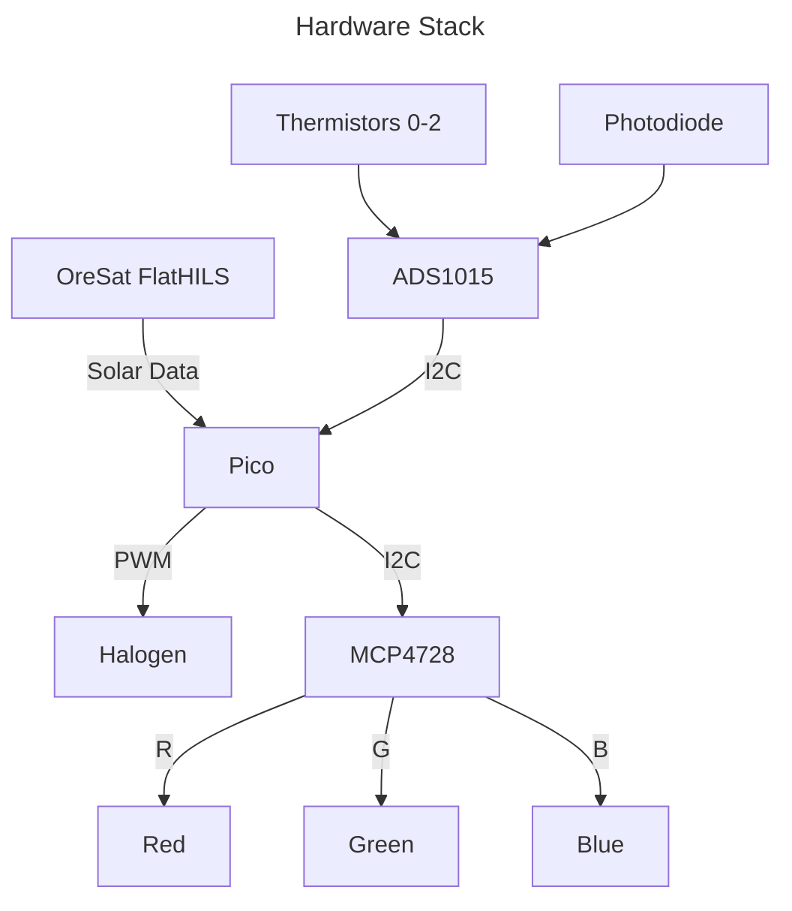

# OreSat Solar Simulator Software

The software that drives the PSAS Solar Simulator for testing OreSat's solar panels. See the [hardware repository](https://github.com/oresat/oresat-solar-simulator-hardware) for information related to the PSAS Solar Simulator hardware design and implementation.

## Overview

The OreSat Solar Simulator is a benchtop simulator for hardware-in-the-loop testing of CubeSat solar modules. It uses LED and halogen light bulbs to emit light that simulates the sun's solar spectrum in low Earth orbit (Air Mass 0 or 'AM0').

## Architecture



## Pre-Installation

Flashing the CircuitPython firmware onto the Raspberry Pi Pico is a well documented exercise.
See [CircuitPython for Raspberry Pi Pico](https://circuitpython.org/board/raspberry_pi_pico/) for the `.uf2` download,
and follow the instructions under "Learn how to install CircuitPython on this board" for detailed instructions.

## Installation

1.  Create and activate a virtual environment.

    > [!TIP]
    > Installing this software in a virtual environment for development and testing purposes is recommended, but not required.

2.  Install the project's primary and "dev" group dependencies.

    ```sh
    pip install --group dev -e .
    ```

3. Write the firmware to a Solar Simulator board attached via USB to your machine.

    ```sh
    make write
    ```

## Interact

The scripts in `scripts` should be used to interact with the simulator.
 - auto.py cycles through a sinusoidal BBQ cycle.
 - manual.py gives various ways of setting a fixed intensity.

## Protocol

The solar simulator is controlled via a USB CDC serial link (typically `/dev/ttyACM0`). Messages
are plain ASCII lines.

### Requests

- A single floating point intensity value between 0 and 1, for example `0.75`. This scales the lights to be as close to the sun spectrum as it can at the given intensity

- Four integers between 0 and 65535, setting the violet, white, cyan, and halogen values respectively. For example `10000 0 0 0`.

### Responses

- A successful request is acknowledged with `OK` and then the values set. `OK 0.75`
- Errors are reported with `ERR` and then a subtype and a short description. `ERR THERM thermal overheat`

## Testing

This project uses [pytest](https://docs.pytest.org/en/stable/). To run the test suite, simply run:

```sh
pytest
```

## Acknowledgements

The original work for this was done as an MCECS Capstone Project from January to June of 2023 by Bendjy Faurestal,
Adam Martinez, Cesar Ordaz-Coronel, and Charles Nasser. Andrew Greenberg was both representing PSAS as the Industry
Sponsor and the Faculty Advisor to the students.

Work to convert the OreSat Solar Simulator Software from using the Beaglebone microcontroller to the Raspberry Pi Pico
was done by OreSat engineers Charlene de la Paz, John Albert Abed, Angeline Vu, and Rose Edington with the assistance of
Industry Advisor Jake Taylor.
